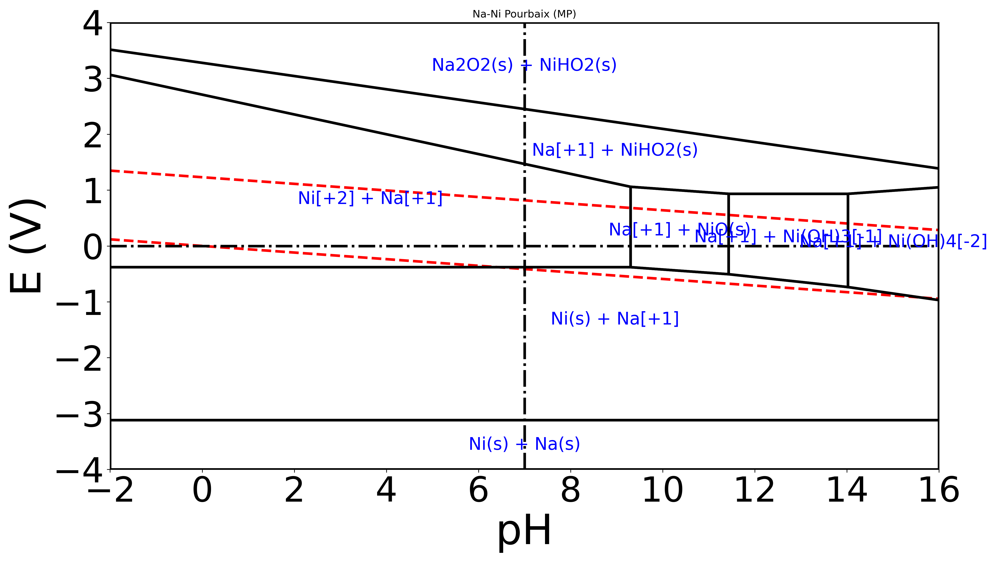
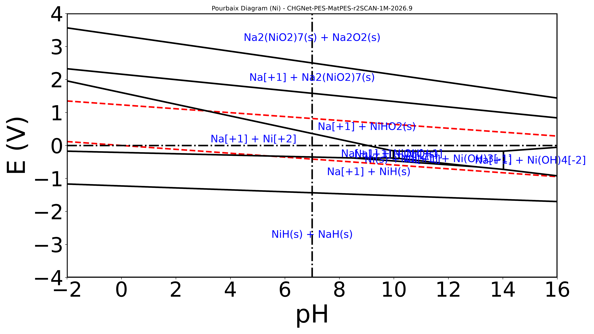

# Na-Ni (2:1) Pourbaix Diagram Example

This example demonstrates the calculation of a multi-element Pourbaix diagram for the Sodium-Nickel system (Na:Ni = 2:1). It highlights the importance of using **r2SCAN-trained MLIPs** (like MatPES) to ensure energy scale compatibility with Materials Project aqueous ions.

## 1. Pure Materials Project (Baseline)

Generated using only Materials Project data (DFT r2SCAN/PBE mix + corrections). This serves as the "ground truth" for stable phases in standard conditions.



**Command:**
```bash
python skills/mat-pourbaix-diagram/scripts/calculate_pourbaix_mp.py \
    --comp_dict "Na=2,Ni=1" \
    --output ./output_mp \
    --title "Na-Ni Pourbaix (MP)"
```

**Key Features:**
- Shows `NiHO2` (NiOOH) and `Na2O2` at high potentials.
- Aqueous ions `Ni[+2]` and `Na[+1]` have large stability domains.

---

## 2. CHGNet MatPES-r2SCAN (Recommended MLIP)

Generated using `CHGNet-PES-MatPES-r2SCAN-1M-2026.9` (re-run 2026-10). This model is trained on r2SCAN data. Its solid formation energies are on MP's scale: NiO (mp-19009) comes out at -1.18 eV/atom, against MP's r2SCAN -1.10 and GGA+U -1.22 eV/atom. That makes the solids compatible with MP aqueous ions.



**Commands** (from the repository root; 86 solids, about 5 min on an NVIDIA GB10):
```bash
venv/run cpu python skills/mat-pourbaix-diagram/scripts/get_pourbaix_structures.py \
    --chemsys "Na-Ni" --output_dir ./NaNi
venv/run mlip python -m src.mcp_server.cli matgl load_model model_name=CHGNet-PES-MatPES-r2SCAN-1M-2026.9 \
    relax_structure structure_data=./NaNi/structures relax_cell=true fmax=0.02 steps=500 output_dir=./relaxed_solids \
    relax_structure structure_data=./NaNi/references relax_cell=true fmax=0.02 steps=500 output_dir=./relaxed_solids
venv/run cpu python skills/mat-pourbaix-diagram/scripts/calculate_pourbaix.py \
    --relaxed_solids ./relaxed_solids \
    --comp_dict "Na=2,Ni=1" \
    --mlip_name "CHGNet-PES-MatPES-r2SCAN-1M-2026.9" \
    --output ./output_mlip \
    --target Ni
```
76 of the 86 relaxations converge within 500 steps; the other 10 are mostly Na–H–O hydrates and
peroxides. The H2O reference comes from `resources/h2o_energies.json`.

**Why it works:**
- MLIP energies on a PBE/GGA absolute scale that are used without matching references or MP2020 corrections put the solids on a different scale from MP's aqueous-ion energies. They can over-stabilize solids and suppress the aqueous ion domains.
- **MatPES-r2SCAN** models align much better with the MP/experimental energy scale, allowing ions and solids to compete correctly.

## Parameters Used
- **Composition**: Na:Ni = 2:1
- **Concentration**: $10^{-6}$ M
- **Voltage Range**: -4 V to +4 V
- **pH Range**: -2 to 16
